# Spendfetti 🎉

> **spend + confetti** — Track your spending, celebrate what you save, and turn it into fun.

[](https://github.com/SedaOzcan1/spendfetti/actions/workflows/ci.yml)
[](LICENSE)


Spendfetti is a full stack personal finance app. Besides tracking income, expenses and budgets, it
rewards good months: when a month closes with money left over, it suggests splitting the surplus
between **savings & investment goals** and a **fun budget**, then shows events you can afford —
with a little confetti along the way.

Built as a portfolio project with **Node.js, Express, MongoDB and React**, from a Figma design.

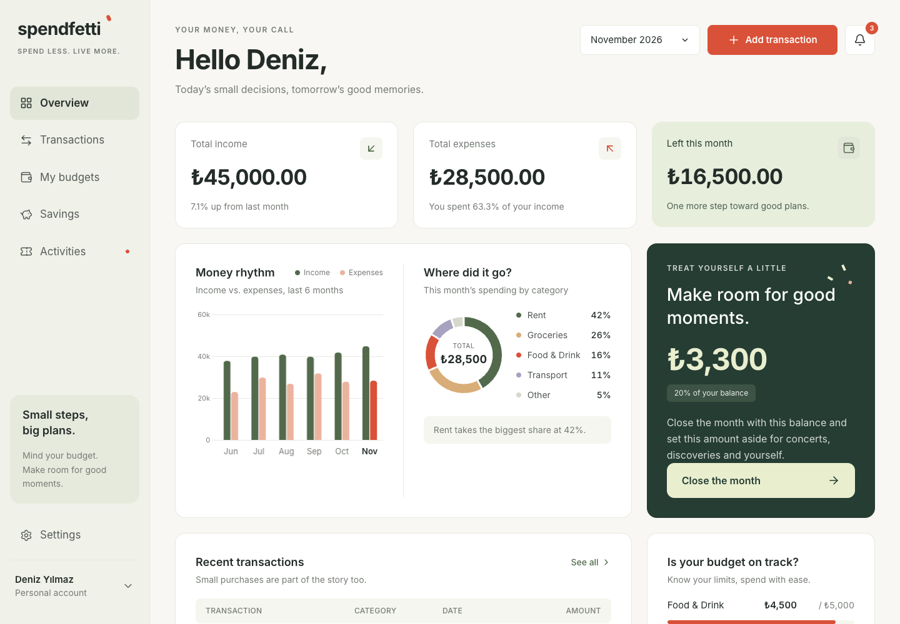

## Features

- **Transactions** — income and expenses with categories, search, filters, sorting and CSV export
- **Overview** — monthly totals, month-over-month change, 6-month trend and spending by category
- **Budgets** — monthly limits per category, warnings at 90% and when a limit is exceeded
- **Savings & investments** — goals with a target amount and date, deposits / withdrawals (not
  counted as spending) and the monthly amount needed to stay on track
- **Month close** — split a month's surplus between a fun budget and your savings goals
- **Activities** — events that fit your remaining fun budget, filtered by city, date, type and
  price, with one-click “add as expense”
- **Notifications** — budget warnings, fun budget running low, goals reached, month-close reminders
- **Celebrations** 🎉 — confetti for real wins (surplus month, budgets met, goals reached), with a
  calm fallback for `prefers-reduced-motion` and a setting to turn it off
- **Account** — cookie-based sessions, remember me, forgot / reset password by email; changing the
  password signs out other devices
- **Responsive** — sidebar on desktop, bottom tabs on mobile

## Screenshots

| Month close                                             | Activities                                           |
| ------------------------------------------------------- | ---------------------------------------------------- |
| 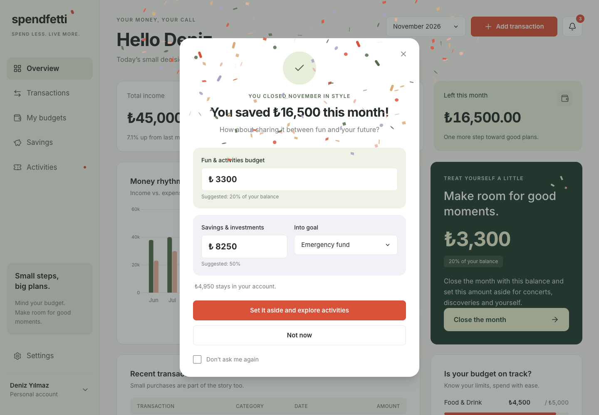 | 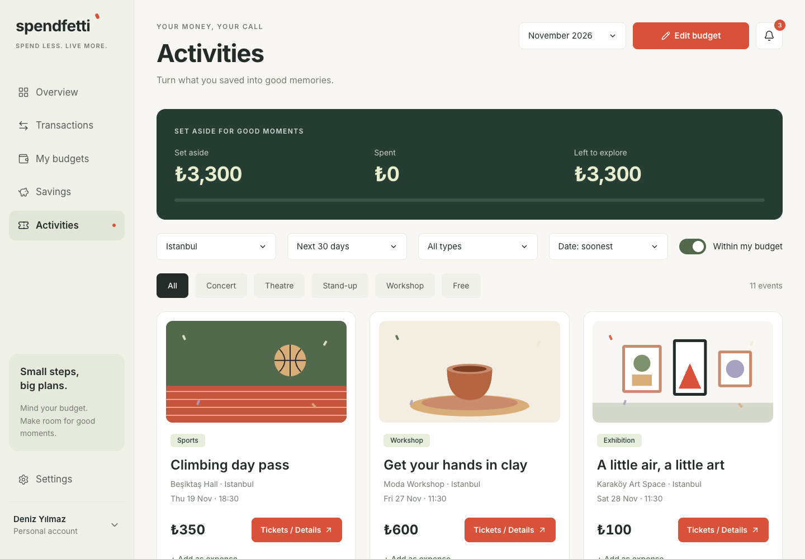       |
| **Savings & investments**                               | **Transactions**                                     |
| 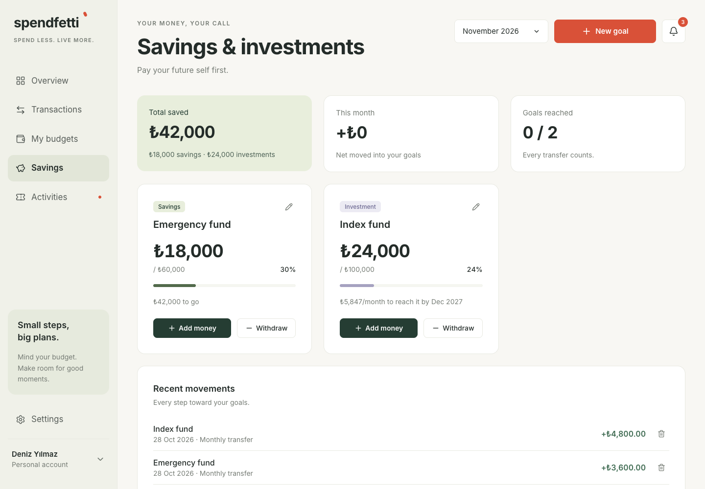                | 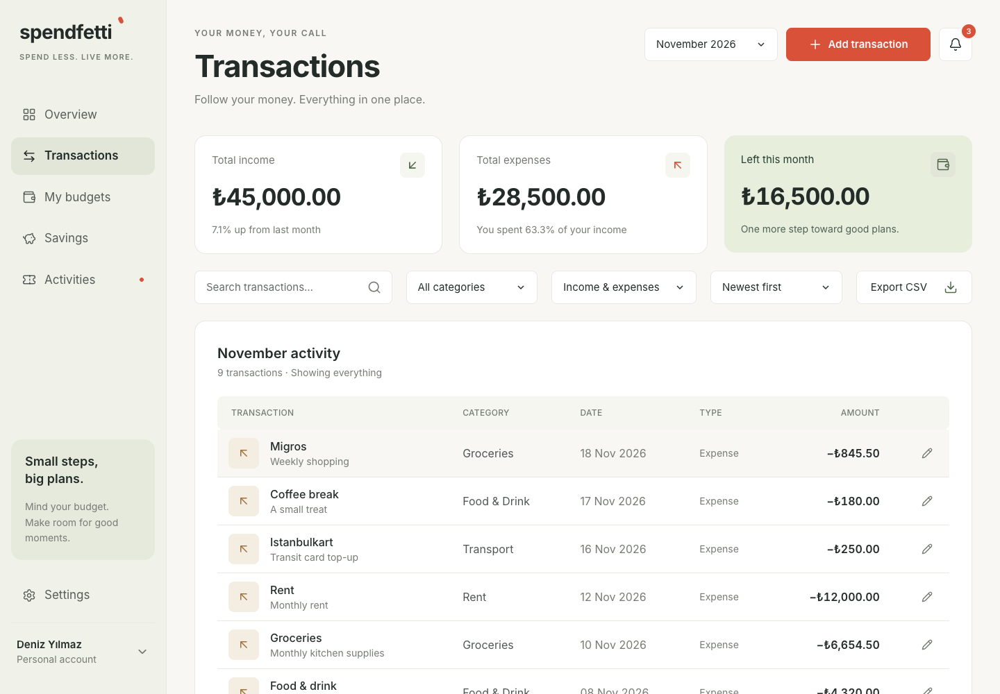   |
| **Budgets**                                             | **Notifications**                                    |
| 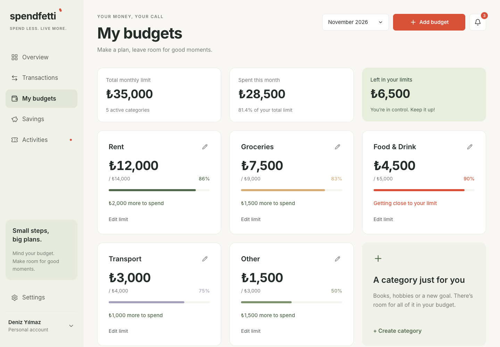                | 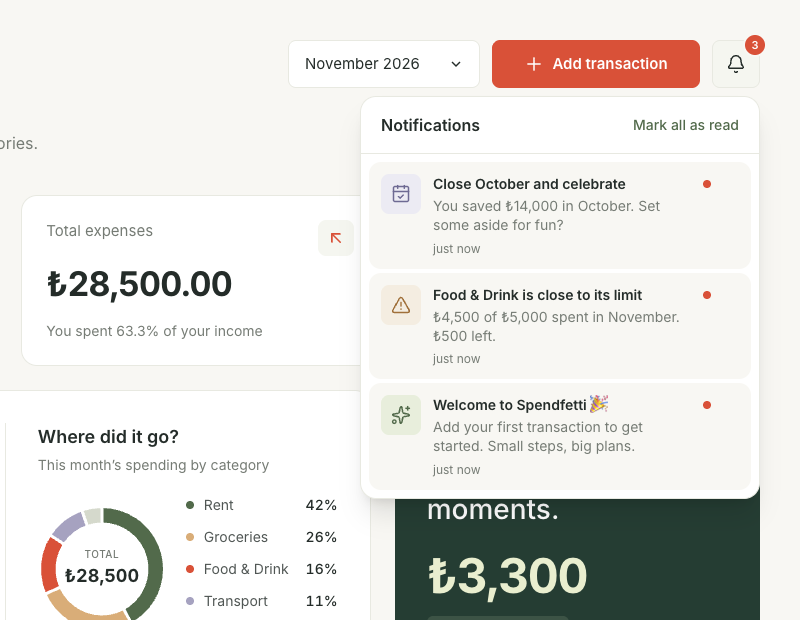 |
| **Sign in**                                             | **Settings**                                         |
| 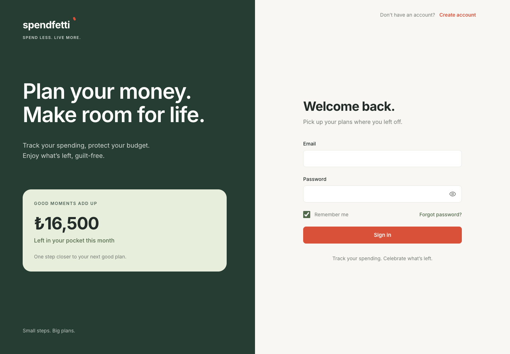                  | 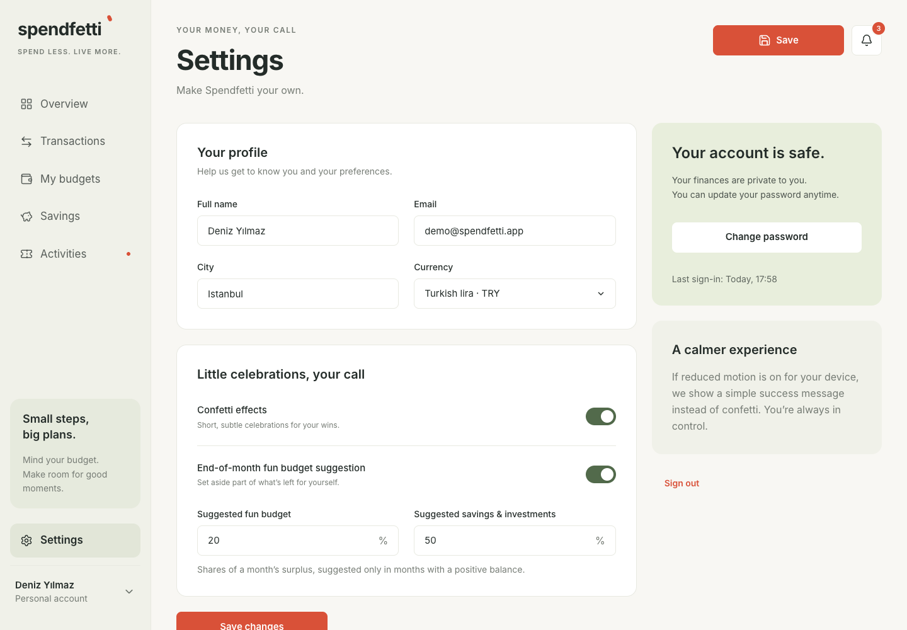           |

**Mobile**

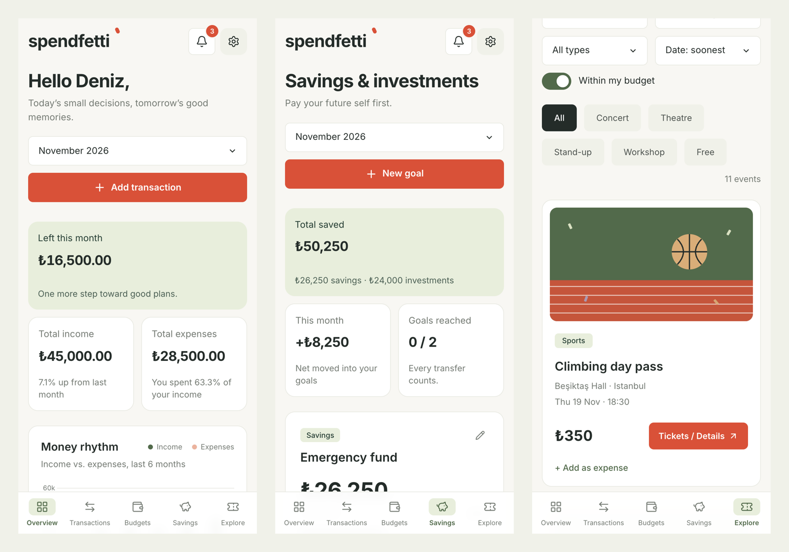

The original Figma mockups are in [`docs/design`](docs/design).

## Tech stack

| Area             | Choice                                                          |
| ---------------- | --------------------------------------------------------------- |
| API              | Node.js 24, Express 5, ES Modules                               |
| Database         | MongoDB with Mongoose (aggregation pipelines, TTL indexes)      |
| Validation       | Zod (shared schemas, validation middleware)                     |
| Auth             | JWT in an httpOnly cookie, bcrypt, rate limiting                |
| Client           | React 19, Vite, React Router, TanStack Query                    |
| UI               | Tailwind CSS v4 (design tokens), lucide icons, Inter            |
| Charts & effects | Chart.js (react-chartjs-2), canvas-confetti (lazy-loaded)       |
| Testing          | Vitest, Supertest, mongodb-memory-server, React Testing Library |
| Tooling          | npm workspaces, ESLint 9, Prettier, GitHub Actions              |

## Architecture

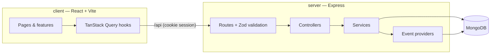

Business rules live in the API so they can be tested in isolation; the client renders what the
API decides (for example which achievements to celebrate or whether to show the month-close prompt).

### Engineering highlights

- **Server-side decisions** — achievements are only earned for _closed_ months, the month-close
  prompt appears at most once per month, and fun + savings can never exceed the month's surplus.
- **Idempotent notifications** — each notification has a per-user dedupe key (e.g.
  `budget_warning:<category>:2026-11`), so the same warning is never sent twice; reminders are
  synced lazily, so no scheduler is needed. Old notifications expire through a TTL index.
- **Pluggable event sources** — an `EventProvider` contract with a seed provider today; a public
  events API can be added as another provider without touching the routes.
- **Session security** — httpOnly cookies, reset tokens stored only as SHA-256 hashes, no account
  enumeration, and sessions issued before a password change are rejected.
- **Accessible celebrations** — one shared, `aria-hidden` canvas; animations are skipped for
  `prefers-reduced-motion`, and every message is announced through an `aria-live` region.
- **Zero-setup development** — an in-memory MongoDB and a demo account with six months of data.

## Getting started

Requirements: Node.js 24 (`nvm use`). MongoDB is optional.

```bash
nvm use
npm install
cp server/.env.example server/.env
npm run dev
```

- Client: http://localhost:5173 (requests to `/api` are proxied to port 4000)
- API: http://localhost:4000/api/health
- Demo account: **demo@spendfetti.app** / **spendfetti1** (six months of sample data)

By default `MONGODB_URI=memory` starts an in-memory MongoDB, so data is reset on restart. Point it
at a local MongoDB or Atlas for persistent data, then load the demo account with
`npm run seed:demo -w server`.

### Environment variables (`server/.env`)

| Variable        | Default                 | Purpose                                                                  |
| --------------- | ----------------------- | ------------------------------------------------------------------------ |
| `MONGODB_URI`   | `memory`                | MongoDB connection string, or `memory` for an in-memory database         |
| `JWT_SECRET`    | dev value               | Secret for session tokens (required in production)                       |
| `CLIENT_ORIGIN` | `http://localhost:5173` | Allowed CORS origin and base URL for email links                         |
| `SEED_DEMO`     | `false`                 | Create / reset the demo account on startup                               |
| `SMTP_URL`      | —                       | SMTP server for password reset emails (logged to the console when unset) |

## Scripts

| Script                          | Description                                        |
| ------------------------------- | -------------------------------------------------- |
| `npm run dev`                   | Start API and client together                      |
| `npm test`                      | Run server and client tests                        |
| `npm run lint`                  | ESLint for the whole repo                          |
| `npm run format`                | Prettier                                           |
| `npm run build`                 | Production build of the client                     |
| `npm run seed:demo -w server`   | Load the demo account into the configured database |
| `npm run seed:events -w server` | Re-seed the sample events                          |

## Testing

- **Server** — integration tests with Supertest against an in-memory MongoDB, covering each
  API area, ownership checks, validation and business rules (budgets, month close, savings,
  achievements, notifications, password reset).
- **Client** — React Testing Library tests for the main flows (auth, transactions, month close,
  activities, savings, notifications, celebrations), including reduced-motion behaviour.
- **CI** — GitHub Actions runs formatting, lint, server tests, client tests and the production build
  on every push.

## Project structure

```
spendfetti/
├── client/
│   └── src/
│       ├── api/            # TanStack Query hooks per resource
│       ├── components/     # layout + UI primitives
│       ├── features/       # dashboard, transactions, budgets, savings, activities, …
│       ├── pages/          # route components (lazy-loaded)
│       └── theme/          # brand colors (shared with confetti)
├── server/
│   ├── src/
│   │   ├── controllers/    # request handlers + Zod schemas
│   │   ├── events/         # EventProvider contract and providers
│   │   ├── models/         # Mongoose models
│   │   ├── services/       # business logic
│   │   └── seed/           # default categories, demo account, sample events
│   └── tests/
└── docs/                   # Figma design references and screenshots
```

## Roadmap

- [x] Transactions, categories, budgets and monthly summary
- [x] Fun budget, activities and confetti celebrations
- [x] Notifications, password reset, savings & investment goals
- [ ] Deployment (Render / Railway, MongoDB Atlas, Vercel)
- [ ] Public events API as a second event provider
- [ ] Recurring transactions and CSV import
- [ ] Investment valuation (market prices) and multi-currency

## License

[MIT](LICENSE) © 2026 Seda Ozcan
