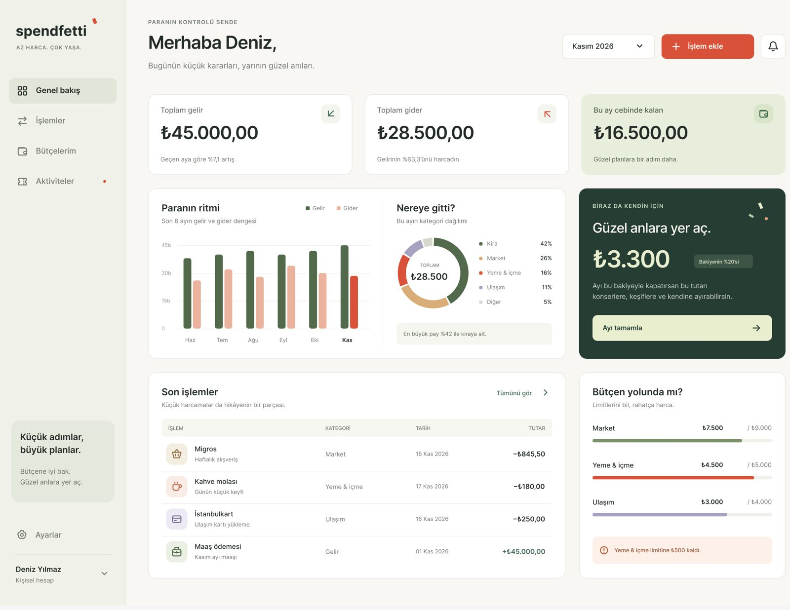
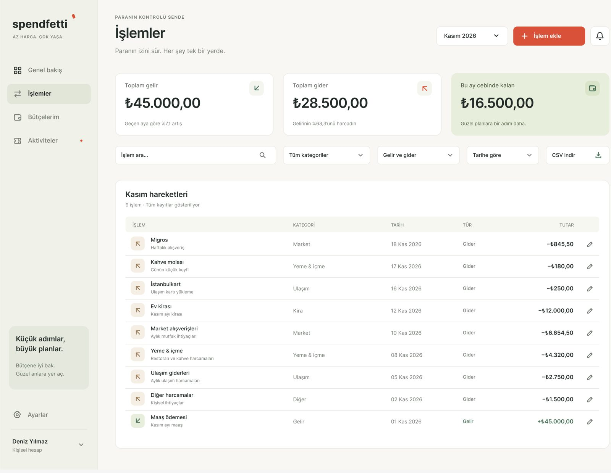
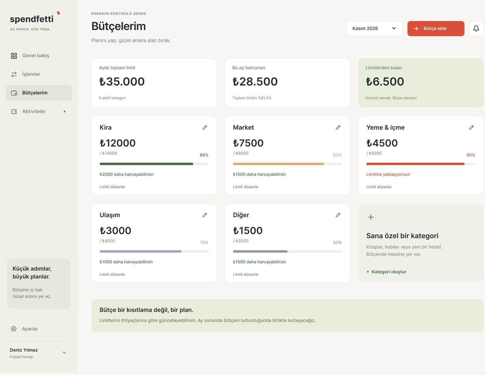

# Spendfetti 🎉

> **spend + confetti** — Track your spending, celebrate what you save, and turn it into fun.

A full stack expense tracker: a Node.js + Express + MongoDB API and a React + Vite client.

## Design

The UI follows the Figma design in [`docs/design`](docs/design) (desktop and mobile).

| Overview                                       | Transactions                                          | Budgets                                     |
| ---------------------------------------------- | ----------------------------------------------------- | ------------------------------------------- |
|  |  |  |

## Structure

```
spendfetti/
├── server/   # Express (ES Modules), Mongoose, Zod, JWT
└── client/   # React + Vite, TanStack Query, Tailwind, Chart.js, canvas-confetti
```

## Requirements

- Node.js 24 (`nvm use`)
- MongoDB is **optional** — the default `MONGODB_URI=memory` starts an in-memory MongoDB (data is wiped on restart). For persistent data, set a local MongoDB or Atlas connection string in `server/.env`.

## Getting started

```bash
nvm use
npm install
cp server/.env.example server/.env

npm run dev   # API + client together
```

- Client: http://localhost:5173 (`/api` requests are proxied to port 4000)
- Demo account (when `SEED_DEMO=true`): **demo@spendfetti.app** / **spendfetti1** — six months of sample data
- API: http://localhost:4000/api/health

To run them separately: `npm run dev:server`, `npm run dev:client`.
To load the demo account into a persistent database: `npm run seed:demo -w server`.

## Scripts

| Script           | Description                    |
| ---------------- | ------------------------------ |
| `npm run dev`    | Start API + client together    |
| `npm run lint`   | ESLint (whole repo)            |
| `npm run format` | Prettier                       |
| `npm test`       | Server + client tests (Vitest) |
| `npm run build`  | Client production build        |

## Roadmap

- [x] T1 Monorepo scaffold
- [x] T2 CI (GitHub Actions)
- [x] T3 Database models
- [x] T4 Auth API
- [x] T5 Transactions & categories API
- [x] T6 Summary & budgets API
- [ ] T7 API integration tests
- [x] T8 Frontend
- [ ] T9 Deploy & README
- [x] T10 Fun budget API
- [x] T11 Events API
- [ ] T12 Fun budget prompt & Activities page
- [ ] T13 Confetti effects
